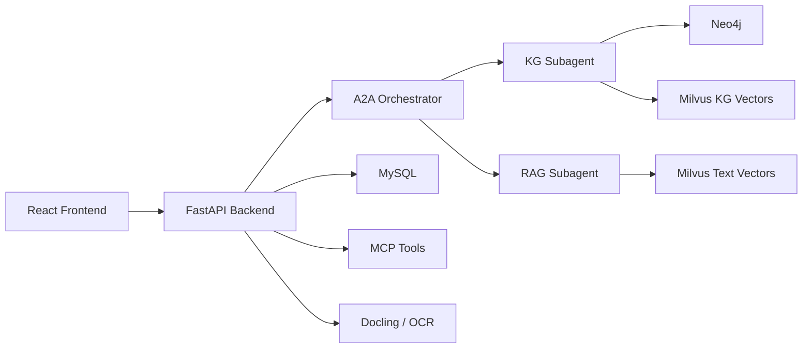

# HypertensionKG QA System

[](./LICENSE)
[](https://www.python.org/)
[](https://fastapi.tiangolo.com/)
[](https://react.dev/)
[](https://github.com/wangmeiwen/hypertension-kg-qa/actions/workflows/backend.yml)
[](https://github.com/wangmeiwen/hypertension-kg-qa/actions/workflows/frontend.yml)
[](https://github.com/wangmeiwen/hypertension-kg-qa/actions/workflows/security.yml)

HypertensionKG QA System 是一个面向高血压领域的知识图谱问答系统。项目以 FastAPI 和 React 为应用层，结合 Neo4j 知识图谱、Milvus 向量检索、MySQL 会话存储、A2A 子代理编排和 LangGraph 工作流，用于构建可追溯、可观测、可管理的医学问答应用。

> 本项目仅用于研究、教学和工程验证，不构成医疗建议。任何健康相关决策都应咨询具备资质的医疗专业人员。

> 项目当前处于预发布阶段，尚未完成临床验证、生产容量验证或稳定版本发布。

## 功能特性

- KG + RAG 协同问答：同时利用知识图谱关系和文本向量召回生成答案。
- A2A 子代理编排：主控代理按问题语义调用图谱子代理和检索子代理。
- 图谱管理后台：支持节点、关系、Cypher、抽取导入和向量化任务管理。
- 文档处理链路：支持上传文档、Docling 解析、OCR 和文本嵌入。
- 用户身份与会话隔离：支持注册、登录、退出和用户令牌认证，聊天数据由服务端登录身份隔离。
- 会话与记忆：保存多轮问答、消息历史、会话记忆和工具观测数据。
- 运行可观测性：提供 readiness、任务队列、运行快照、观测事件和性能基线。
- 前后端自动化测试：覆盖核心后端服务、路由集成和前端组件/E2E 场景。

## 架构概览



## 技术栈

| 层级  | 技术                                               |
| ----- | -------------------------------------------------- |
| 后端  | Python, FastAPI, SQLAlchemy, aiomysql, A2A SDK     |
| Agent | LangChain, LangGraph, MCP Tools                    |
| 图谱  | Neo4j, Cypher, PyMilvus graph collection           |
| 检索  | Milvus, sentence-transformers, reranker            |
| 文档  | Docling, PyMuPDF, pdfplumber, python-docx, OCR     |
| 前端  | React, Vite, React Router, TanStack Query, Zustand |
| 测试  | pytest, Vitest, Playwright, Ruff, Black, mypy      |

## 目录结构

```text
.
├─ app/
│  ├─ a2a/                  # A2A 主控、子代理、运行时与客户端
│  ├─ backend/              # FastAPI 应用、路由、服务、仓储与安全
│  ├─ core/                 # 配置、并发、特性开关和性能日志
│  ├─ document_parser/      # Docling 与 OCR 文档解析链路
│  ├─ frontend/             # React + Vite 前端应用
│  ├─ knowledge_graph/      # Neo4j 图谱管理与抽取工具
│  ├─ mcp/                  # MCP 工具注册与服务端
│  └─ rag_core/             # 向量化、召回、重排与共享资源
├─ docker/                  # 本地基础设施配置
├─ tests/                   # 自动化测试、评估脚本和维护脚本
├─ .env.example             # 环境变量模板
├─ requirements.txt         # Python 依赖
└─ README.md
```

项目文档：

- [CONTRIBUTING.md](./CONTRIBUTING.md)：开发、测试和贡献流程；
- [CODE_OF_CONDUCT.md](./CODE_OF_CONDUCT.md)：社区行为准则；
- [SECURITY.md](./SECURITY.md)：安全漏洞私有报告流程；
- [SUPPORT.md](./SUPPORT.md)：使用支持和问题反馈范围。

## 环境要求

- Python 3.11+
- Node.js 20.19+ 或 22.12+
- npm 10+
- MySQL 8+
- Neo4j 5+
- Milvus 2+
- 可用的大模型 API key
- 本地嵌入模型和 reranker 模型

Neo4j 和 Milvus 不可用时，后端可以降级启动，但图谱与检索能力会受限。MySQL 是核心依赖，未就绪会阻断主要问答接口。

## 快速开始

### 1. 克隆项目

```powershell
git clone https://github.com/wangmeiwen/hypertension-kg-qa.git
cd hypertension-kg-qa
```

### 2. 安装后端依赖

```powershell
python -m venv .venv
.\.venv\Scripts\Activate.ps1
pip install -r requirements.txt
```

Conda 用户也可以使用已有环境：

```powershell
conda activate hypertension-qa
pip install -r requirements.txt
```

### 3. 安装前端依赖

```powershell
cd app/frontend
npm install
cd ../..
```

### 4. 配置环境变量

```powershell
Copy-Item .env.example .env
```

按本地环境修改 `.env`，至少配置以下变量：

```env
MODEL_API_KEY=your-model-api-key
MODEL_BASE_URL=https://your-llm-endpoint
MODEL_NAME=your-model-name
SESSION_MEMORY_MODEL_NAME=your-session-memory-model-name

MYSQL_HOST=127.0.0.1
MYSQL_USER=root
MYSQL_PASSWORD=your-mysql-password
MYSQL_DATABASE=hypertension_kg

NEO4J_URI=bolt://127.0.0.1:7687
NEO4J_USER=neo4j
NEO4J_PASSWORD=your-neo4j-password

MILVUS_HOST=127.0.0.1
MILVUS_PORT=19531
MILVUS_DATABASE_NAME=hypertension_kg

ADMIN_USERNAME=admin
ADMIN_PASSWORD=change-me
```

完整配置见 [.env.example](./.env.example)。项目不为内部配置提供静默回退，缺失的必需配置应在启动阶段暴露出来。

### 5. 启动 Milvus

仓库提供了本地 Milvus Compose：

```powershell
cd docker/milvus
docker compose -f docker-compose.milvus2.yml up -d
cd ../..
```

该 Compose 将 Milvus gRPC 端口映射为 `19531`，因此 `.env` 中应使用 `MILVUS_PORT=19531`。

### 6. 启动后端

```powershell
uvicorn app.backend.main:app --reload --host 0.0.0.0 --port 8000
```

后端启动时会读取 `.env`、初始化 MySQL 表结构、检查外部依赖、注册 MCP 工具，并准备 A2A 运行时。

### 7. 启动前端

```powershell
cd app/frontend
$env:VITE_BACKEND_URL="http://127.0.0.1:8000"
npm run dev
```

默认访问地址：

- 前端：http://127.0.0.1:5173
- 后端：http://127.0.0.1:8000
- Readiness：http://127.0.0.1:8000/health/readiness

## 常用接口

### 用户认证

- `POST /auth/register`
- `POST /auth/login`
- `GET /auth/me`
- `POST /auth/logout`

注册和登录成功后会返回用户令牌。问答、会话和用户文件接口必须通过 `Authorization: Bearer <token>` 传入令牌；服务端从令牌确定用户身份，不接受客户端用 `user_id` 指定数据归属。管理员认证使用独立的 `/admin/*` 接口和令牌。

### 问答与会话

- `POST /process`
- `POST /process_with_session`
- `POST /agent/run`
- `GET /sessions`
- `POST /sessions`
- `GET /sessions/{session_id}/messages`
- `POST /upload_file`

### 图谱

- `GET /graph/visualization`
- `GET /graph/entity/{entity_id}`
- `GET /admin/graph/nodes`
- `POST /admin/graph/nodes`
- `POST /admin/graph/jobs/extract-import`
- `POST /admin/graph/jobs/embed-milvus`

### 管理与观测

- `POST /admin/login`
- `GET /admin/status`
- `GET /admin/sessions`
- `GET /admin/agent/observability-summary`
- `GET /admin/runtime/flags`
- `GET /admin/qa/queue/status`

### 系统

- `GET /health/readiness`
- `GET /db/status`
- `GET /mcp/tools`
- `POST /mcp/invoke`
- `GET /a2a/agent-card`
- `GET /a2a/tasks`

## Readiness 状态

`GET /health/readiness` 返回服务依赖状态：

- `ready`：关键依赖和可选依赖均可用。
- `degraded`：关键依赖可用，Neo4j、Milvus、MCP 等能力部分降级。
- `unavailable`：关键依赖不可用，主要问答接口会返回 `503`。

## 测试与质量检查

后端：

```powershell
python -m pytest tests/automated -m "not db"
python -m pytest tests/automated -m db
ruff check app tests
black --check app tests
mypy app
python -m pip_audit -r requirements.txt
```

前端：

```powershell
cd app/frontend
npm run format:check
npm run lint
npm run typecheck
npm run stylelint
npm run test:coverage
npm run test:e2e
npm run build
npm run security:audit
```

`-m db` 测试要求真实 MySQL、Neo4j 和 Milvus 可用。`npm run test:e2e` 会启动确定性后端与 Vite，并要求当前 Python 命令来自已安装后端依赖的环境；使用本项目时应先激活 Conda `hypertension-qa`。组件测试和确定性 E2E 通过不等于真实数据库、模型效果或医疗质量已经验证。

## 数据与模型

项目可以读取以下本地资源：

- `data/`：本地领域文档、图谱元数据或评估数据。
- `model/bge-m3`：本地嵌入模型。
- `model/bge-reranker-large`：本地重排模型。

仓库不分发第三方医学全文、模型权重或私有评估数据。公开可访问不等于允许再次分发，使用者应自行获取资料并遵守来源授权。具体目录约定和指南来源见 [data/README.md](./data/README.md)。

## 贡献指南

欢迎通过 issue 或 pull request 参与改进。开发环境、测试范围、提交要求和数据授权约束见 [CONTRIBUTING.md](./CONTRIBUTING.md)。参与项目即表示同意遵守 [CODE_OF_CONDUCT.md](./CODE_OF_CONDUCT.md)。

## 安全说明

请不要提交真实 API key、数据库密码、患者隐私数据或未授权医学资料。发现安全问题时，请按照 [SECURITY.md](./SECURITY.md) 使用 GitHub 私有漏洞报告入口，不要在公开 issue 中披露敏感细节。

仓库通过独立安全工作流执行 Python/前端依赖审计、`detect-secrets` 基线扫描和固定容器镜像的 Trivy 严重漏洞扫描。范围受控的临时例外分别记录在前端审计脚本、Ragas 独立依赖文件和 [.trivyignore.yaml](./.trivyignore.yaml) 中；例外必须绑定具体通告及适用路径，容器例外还必须设置到期时间，不能用全局忽略替代修复。

## 许可证

本项目采用 [Apache License 2.0](./LICENSE)。

该许可证只覆盖仓库中由项目贡献者创作并提交的代码和文档；第三方医学资料、数据、模型和商标仍受各自条款约束。使用帮助见 [SUPPORT.md](./SUPPORT.md)。
