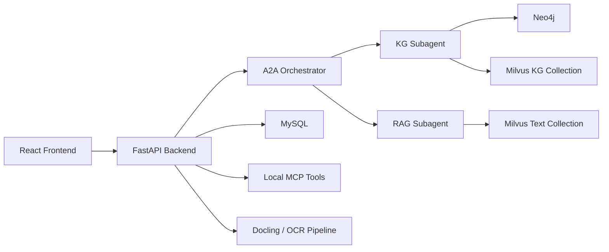

# HypertensionKG QA System

高血压领域知识图谱问答系统。以 `FastAPI + React` 为应用层，融合 `Neo4j` 知识图谱、`Milvus` 向量检索、`MySQL` 会话存储，以及 `A2A + LangGraph` 编排，用于实现问答、图谱管理、文档解析与可观测能力。

## 项目亮点

- KG + RAG 协同检索，覆盖图谱语义与文本片段召回
- A2A 主控编排，支持图谱子代理与检索子代理协作
- 文档上传、Docling 解析与 OCR 支持图谱抽取与嵌入
- readiness 分级区分 `ready / degraded / unavailable`
- 管理后台覆盖图谱管理、会话与观测、任务状态与运行快照

## 系统架构



## 技术栈

### 后端

- Python 3.11.14
- FastAPI
- SQLAlchemy 2.x + asyncmy
- LangChain / LangGraph
- A2A SDK
- Neo4j Python Driver
- PyMilvus
- Docling
- OpenAI / ZhipuAI 接口
- LangSmith（可选）

### 前端

- React 18.3
- Vite 5
- React Router 7
- TanStack Query
- Zustand
- react-force-graph-2d
- Vitest / Playwright

### 基础设施

- MySQL 8.x
- Neo4j 5.x
- Milvus 2.x
- MinIO（Milvus 依赖）

## 目录结构

```text
.
├─ app/
│  ├─ a2a/                  # A2A 主控、子代理、运行时
│  ├─ backend/              # FastAPI 应用、路由、服务、仓储
│  ├─ common/               # 公共配置、鉴权、日志、速率限制
│  ├─ document_parser/      # Docling 与 OCR 解析链路
│  ├─ frontend/             # React + Vite 前端
│  ├─ knowledge_graph/      # Neo4j 图谱管理与抽取逻辑
│  ├─ mcp/                  # MCP 工具与工具注册
│  └─ rag_core/             # 向量化、召回、重排与共享资源
├─ data/                    # 数据样例、图谱元数据、输入文档
├─ docker/
│  └─ milvus/               # Milvus 本地 docker-compose
├─ docs/                    # 设计文档、接口文档、论文材料
├─ logs/                    # API 日志、会话日志、性能日志
├─ model/                   # 本地嵌入模型与 reranker
├─ runtime_cache/           # 运行期缓存
├─ tests/                   # 维护脚本（非完整单元测试套件）
├─ tmp/                     # 临时输出
├─ uploads/                 # 上传文件
├─ .env.example
├─ requirements.txt
└─ README.md
```

## 运行环境

- Python：`3.11.14`
- Node.js：`24.13.0`
- npm：`11.6.2`
- Conda 环境名：`hypertension-qa`

## 依赖服务

- MySQL：会话、消息、记忆、OCR 与图谱导入任务存储
- Neo4j：高血压知识图谱
- Milvus：文档向量与图谱向量
- 大模型接口：问答、图谱抽取、会话记忆压缩

说明：

- MySQL 是 readiness 的关键依赖，失败会导致核心问答接口返回 `503`
- Neo4j 与 Milvus 属于可选依赖，异常时 readiness 会变成 `degraded`
- 仓库内 Milvus Compose 暴露端口是 `19531:19530`，使用该 Compose 时请将 `MILVUS_PORT` 设为 `19531`

## 快速开始

### 1. 安装依赖

```powershell
conda activate hypertension-qa
pip install -r requirements.txt
```

前端依赖：

```powershell
cd app/frontend
npm install
cd ../..
```

### 2. 配置 `.env`

项目启动时会读取根目录 `.env`。可从 `.env.example` 拷贝后按需修改。最低配置建议：

```env
# LLM
MODEL_API_KEY=your-model-api-key
MODEL_BASE_URL=https://your-llm-endpoint
MODEL_NAME=your-model-name
SESSION_MEMORY_MODEL_NAME=your-session-memory-model-name

# MySQL
MYSQL_HOST=127.0.0.1
MYSQL_USER=root
MYSQL_PASSWORD=your-password
MYSQL_DATABASE=hypertension_kg

# Neo4j
NEO4J_URI=bolt://127.0.0.1:7687
NEO4J_USER=neo4j
NEO4J_PASSWORD=your-password

# Milvus
MILVUS_HOST=127.0.0.1
MILVUS_PORT=19531
MILVUS_DATABASE_NAME=hypertension_kg

# OCR / multimodal（可选）
ZHIPU_API_KEY=your-zhipu-api-key

# Admin
ADMIN_USERNAME=admin
ADMIN_PASSWORD=change-me
```

完整变量请参考 `.env.example`（含 LLM 超时/重试、RAG/KG 召回、A2A 限制、限流/熔断等）与以下配置聚合位置：

- [app/common/config.py](./app/common/config.py)
- [app/backend/config.py](./app/backend/config.py)

### 3. 启动 Milvus

```powershell
cd docker/milvus
docker compose -f docker-compose.milvus2.yml up -d
cd ../..
```

端口映射：

- Milvus gRPC：`19531`
- Milvus HTTP：`9092`
- MinIO：`9002 / 9003`

### 4. 启动后端

```powershell
conda activate hypertension-qa
uvicorn app.backend.main:app --reload --host 0.0.0.0 --port 8000
```

启动后会自动完成：

- 读取根目录 `.env`
- 初始化 MySQL 数据库与表结构
- 检查 Neo4j / Milvus 连接
- 预热共享向量检索资源
- 初始化 MCP 工具与 A2A 运行时

### 5. 启动前端

```powershell
cd app/frontend
$env:VITE_BACKEND_URL="http://127.0.0.1:8000"
npm run dev
```

开发地址：

- 前端：`http://127.0.0.1:5173`
- 后端：`http://127.0.0.1:8000`

## 初始化说明

### MySQL

后端启动时会自动创建以下核心表：

- `sessions`
- `messages`
- `session_memory`
- `token_usage`
- `ocr_documents`
- `ocr_document_pages`
- `ocr_token_usage`
- `graph_import_runs`
- `graph_import_chunks`

### Neo4j

默认连接地址：`bolt://127.0.0.1:7687`。图谱可视化、实体详情、图谱管理和部分 A2A 图谱能力依赖 Neo4j。

### Milvus

向量数据分为两类：

- 文档向量集合：面向 RAG 文本召回
- 图谱向量集合：面向实体关系语义检索

默认本地模型路径：

- `model/bge-m3`
- `model/bge-reranker-large`

## 主要接口

更完整说明见 [docs/api_endpoints.md](./docs/api_endpoints.md)。常用接口：

### 用户侧

- `POST /process`
- `POST /process_with_session`
- `POST /agent/run`
- `GET /sessions`
- `POST /sessions`
- `GET /graph/visualization`
- `GET /graph/entity/{entity_id}`
- `POST /upload_file`

### 管理侧

- `POST /admin/login`
- `GET /admin/status`
- `GET /admin/sessions`
- `GET /admin/agent/observability-summary`
- `GET /admin/agent/observability-runs`
- `GET /admin/graph/labels`
- `GET /admin/graph/nodes`
- `POST /admin/graph/jobs/extract-import`
- `POST /admin/graph/jobs/embed-milvus`
- `GET /admin/graph/embed-status`
- `POST /admin/docling/parse`
- `POST /admin/docling/parse-and-embed`

### 系统侧

- `GET /health/readiness`
- `GET /mcp/tools`
- `POST /mcp/invoke`
- `GET /a2a/agent-card`
- `GET /a2a/tasks`

## Readiness 机制

`GET /health/readiness` 会返回服务就绪状态：

- `ready`：关键依赖与可选依赖都可用
- `degraded`：关键依赖可用，但 Neo4j、Milvus、MCP 核心工具等降级
- `unavailable`：关键依赖未就绪（当前主要为 MySQL 初始化失败）

当状态为 `unavailable` 时，以下接口会被阻断：

- `/process`
- `/agent/run`
- `/process_with_session`

## 管理员登录

管理员账号没有硬编码默认值，需在 `.env` 中同时配置：

- `ADMIN_USERNAME`
- `ADMIN_PASSWORD`

## 前端说明

前端位于 [app/frontend](./app/frontend)。建议在 `app/frontend/.env` 配置：

```env
VITE_BACKEND_URL=http://127.0.0.1:8000
```

如需放开跨域来源，可在根目录 `.env` 中调整 `ALLOWED_ORIGINS`。

## 数据与模型

- [data](./data)：样例 PDF、DOCX 与图谱元数据
- [model/bge-m3](./model/bge-m3)
- [model/bge-reranker-large](./model/bge-reranker-large)

## 开发与维护

### 推荐命令

```powershell
# 代码风格
ruff check app tests
black app tests

# 类型检查
mypy app

# 运行 pytest
pytest
```

### 前端命令（app/frontend）

```powershell
npm run lint
npm run test
npm run test:e2e
npm run build
```

### 当前测试现状

`tests/` 目录主要用于维护脚本（如清空 Neo4j、清理 Milvus），自动化测试覆盖仍不完整。

## 常见问题

### 1. 服务启动后问答接口直接返回 503

优先检查：

- `MYSQL_PASSWORD` 是否配置
- MySQL 是否可连接
- `GET /health/readiness` 返回的 `critical_not_ready` 字段

### 2. Milvus 启动后仍无法连接

若使用仓库自带的 `docker/milvus/docker-compose.milvus2.yml`，请确认：

```env
MILVUS_PORT=19531
```

因为该 Compose 对外暴露的是 `19531`，不是默认 `19530`。

### 3. 管理员无法登录

检查：

- `.env` 是否配置 `ADMIN_USERNAME`
- `.env` 是否配置 `ADMIN_PASSWORD`
- 前端是否指向正确的后端地址

### 4. Neo4j 或 Milvus 未启动能否使用

可以。后端通常仍能启动，但 readiness 会降级为 `degraded`，图谱或检索能力会受影响。

## 相关文档

- [docs/api_endpoints.md](./docs/api_endpoints.md)
- [docs/backend_study_guide.md](./docs/backend_study_guide.md)

## 许可证

本项目采用 [LICENSE](./LICENSE) 中声明的许可证。
