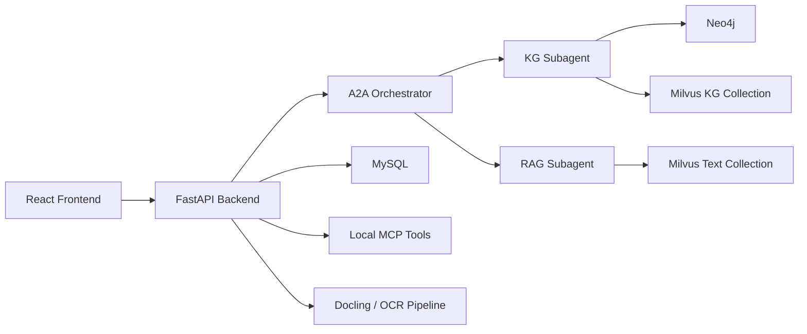

# HypertensionKG QA System

高血压领域知识图谱问答系统。项目以 `FastAPI + React` 为应用层，结合 `Neo4j` 知识图谱、`Milvus` 向量检索、`MySQL` 会话与任务存储，以及基于 `A2A + LangGraph` 的问答编排，用于实现面向高血压场景的智能问答、知识图谱管理、文档解析与可观测性管理。

## 项目特性

- 面向高血压领域的问答系统，支持知识图谱检索与向量检索协同工作
- 支持多轮会话、会话记忆、流式响应、历史会话管理
- 提供 A2A 主控与子代理能力，包含图谱子代理与检索子代理
- 提供图谱可视化、实体详情查看、后台图谱编辑与只读 Cypher 查询
- 支持文档上传、Docling 解析、OCR、图谱抽取导入、Milvus 嵌入
- 内置 readiness 分级，能区分 `ready / degraded / unavailable`
- 提供 Agent 观测、性能基线、运行时特性开关与后台任务状态接口

## 技术栈

### 后端

- Python 3.11.14
- FastAPI
- SQLAlchemy + asyncmy
- LangChain / LangGraph
- Neo4j Python Driver
- PyMilvus
- Docling
- OpenAI / ZhipuAI 接口

### 前端

- React 18
- Vite
- react-force-graph-2d

### 基础设施

- MySQL 8.x
- Neo4j 5.x
- Milvus 2.x

## 系统架构



## 目录结构

```text
.
├─ app/
│  ├─ a2a/                  # A2A 主控、子代理、运行时
│  ├─ backend/              # FastAPI 应用、路由、服务、仓储
│  ├─ common/               # 公共配置、鉴权、日志、速率限制
│  ├─ document_parser/      # Docling 与 OCR 解析链路
│  ├─ frontend/             # React + Vite 前端
│  ├─ knowledge_graph/      # Neo4j 图谱管理与抽取逻辑
│  ├─ mcp/                  # MCP 工具与工具注册
│  └─ rag_core/             # 向量化、召回、重排与共享资源
├─ config/                  # 运行配置
├─ data/                    # 数据样例、图谱元数据、输入文档
├─ docker/
│  └─ milvus/               # Milvus 本地 docker-compose
├─ docs/                    # 设计文档、接口文档、论文材料
├─ logs/                    # API 日志、会话日志、性能日志
├─ model/                   # 本地嵌入模型与 reranker
├─ runtime_cache/           # 运行期缓存
├─ tests/                   # 维护脚本（当前不是真正的单元测试目录）
└─ requirements.txt
```

## 核心能力

### 1. 智能问答

- `POST /process`：基础流式问答入口
- `POST /process_with_session`：带会话保存的流式问答入口
- `POST /agent/run`：A2A 编排入口，支持主控调度图谱与检索子代理

### 2. 图谱与检索

- 公开图谱可视化：`GET /graph/visualization`
- 实体详情查看：`GET /graph/entity/{entity_id}`
- 图谱语义检索：基于知识图谱专用 Milvus 集合
- 文本片段检索：基于文档向量库的 RAG 检索

### 3. 管理后台

- 管理员登录态校验
- 会话、消息、记忆与观测信息管理
- 图谱节点与关系的增删改查
- 只读 Cypher 查询
- 文档上传、Docling 解析、图谱抽取导入、图谱嵌入 Milvus

### 4. 可用性与观测

- readiness 检查：`GET /health/readiness`
- 后台运行时快照与性能基线
- Agent 运行汇总与明细接口
- 速率限制与可选的熔断配置

## 运行环境

当前仓库与你本地环境一致的推荐版本：

- Python：`3.11.14`
- Node.js：`24.13.0`
- npm：`11.6.2`
- Conda 环境名：`hypertension-qa`

## 依赖服务

启动系统前，需要准备以下依赖：

- MySQL：保存会话、消息、记忆、OCR 与图谱导入任务数据
- Neo4j：保存高血压知识图谱
- Milvus：保存文档向量与图谱实体关系向量
- 大模型接口：问答、图谱抽取、会话记忆压缩等能力依赖外部模型服务

注意：

- MySQL 是 readiness 中的关键依赖。若 MySQL 初始化失败，核心问答接口会返回 `503`
- Neo4j 和 Milvus 当前属于非关键依赖。它们不可用时，服务可能仍启动，但 readiness 会变成 `degraded`
- 仓库自带的 Milvus Compose 暴露端口是 `19531:19530`，如果直接使用该 Compose，需要在 `.env` 中把 `MILVUS_PORT` 配成 `19531`

## 快速开始

### 1. 激活环境并安装依赖

```powershell
conda activate hypertension-qa
pip install -r requirements.txt
```

前端依赖：

```powershell
cd app/frontend
npm install
cd ../..
```

### 2. 配置 `.env`

项目会在启动时自动读取根目录 `.env`。至少需要配置以下变量：

```env
# LLM
MODEL_API_KEY=your-api-key
MODEL_BASE_URL=https://your-llm-endpoint
MODEL_NAME=your-model-name

# MySQL
MYSQL_HOST=127.0.0.1
MYSQL_USER=root
MYSQL_PASSWORD=your-password
MYSQL_DATABASE=hypertension_kg

# Neo4j
NEO4J_URI=bolt://127.0.0.1:7687
NEO4J_USER=neo4j
NEO4J_PASSWORD=your-password

# Milvus
MILVUS_HOST=127.0.0.1
MILVUS_PORT=19530
MILVUS_DATABASE_NAME=hypertension_kg

# Admin
ADMIN_USERNAME=admin
ADMIN_PASSWORD=change-me
```

如果要启用图谱抽取多路模型、LangSmith 或 Zhipu OCR，还可以继续补充：

- `GRAPH_LLM_1_*` 到 `GRAPH_LLM_3_*`
- `LANGSMITH_*`
- `ZHIPU_API_KEY`
- 速率限制与熔断相关变量

代码里已经实际读取的环境变量可以参考：

- [app/common/config.py](./app/common/config.py)
- [app/backend/config.py](./app/backend/config.py)

### 3. 启动 Milvus

如果使用仓库自带 Docker Compose：

```powershell
cd docker/milvus
docker compose -f docker-compose.milvus2.yml up -d
cd ../..
```

默认映射：

- Milvus gRPC：`19531`
- Milvus HTTP：`9092`
- MinIO：`9002 / 9003`

### 4. 启动后端

```powershell
conda activate hypertension-qa
uvicorn app.backend.main:app --reload --host 0.0.0.0 --port 8000
```

首次启动行为：

- 自动读取根目录 `.env`
- 自动尝试初始化 MySQL 数据库与表结构
- 自动检查 Neo4j / Milvus 连接
- 自动预热共享向量检索资源
- 自动初始化 MCP 工具和 A2A 运行时

### 5. 启动前端

```powershell
cd app/frontend
$env:VITE_BACKEND_URL="http://127.0.0.1:8000"
npm run dev
```

开发地址：

- 前端：`http://127.0.0.1:5173`
- 后端：`http://127.0.0.1:8000`

## 初始化与运行说明

### MySQL

后端启动时会自动创建以下核心表：

- `sessions`
- `messages`
- `session_memory`
- `token_usage`
- `ocr_documents`
- `ocr_document_pages`
- `ocr_token_usage`
- `graph_import_runs`
- `graph_import_chunks`

因此通常不需要手工建表，但前提是：

- MySQL 服务本身可访问
- `.env` 中的 `MYSQL_PASSWORD` 已正确配置

### Neo4j

项目默认使用：

- `bolt://127.0.0.1:7687`

图谱可视化、实体详情、图谱管理和部分 A2A 图谱能力都会依赖 Neo4j。

### Milvus

项目包含两类主要向量数据：

- 文档向量集合：面向 RAG 文本召回
- 图谱向量集合：面向实体关系语义检索

本地模型默认路径：

- `model/bge-m3`
- `model/bge-reranker-large`

## 主要接口

更完整的接口说明见 [docs/api_endpoints.md](./docs/api_endpoints.md)。

常用接口如下：

### 用户侧

- `POST /process`
- `POST /process_with_session`
- `POST /agent/run`
- `GET /sessions`
- `POST /sessions`
- `GET /graph/visualization`
- `GET /graph/entity/{entity_id}`
- `POST /upload_file`

### 管理侧

- `POST /admin/login`
- `GET /admin/status`
- `GET /admin/sessions`
- `GET /admin/agent/observability-summary`
- `GET /admin/agent/observability-runs`
- `GET /admin/graph/labels`
- `GET /admin/graph/nodes`
- `POST /admin/graph/jobs/extract-import`
- `POST /admin/graph/jobs/embed-milvus`
- `GET /admin/graph/embed-status`
- `POST /admin/docling/parse`
- `POST /admin/docling/parse-and-embed`

### 系统侧

- `GET /health/readiness`
- `GET /mcp/tools`
- `POST /mcp/invoke`
- `GET /a2a/agent-card`
- `GET /a2a/tasks`

## Readiness 机制

`GET /health/readiness` 会返回服务就绪状态：

- `ready`：关键依赖与可选依赖都基本可用
- `degraded`：关键依赖可用，但 Neo4j、Milvus、MCP 核心工具等存在降级
- `unavailable`：关键依赖未就绪，当前主要是 MySQL 初始化失败

当状态为 `unavailable` 时，以下核心问答接口会被阻断：

- `/process`
- `/agent/run`
- `/process_with_session`

## 管理员登录说明

管理员账号没有硬编码默认值。只有在 `.env` 中同时配置了以下变量后，管理员登录才会生效：

- `ADMIN_USERNAME`
- `ADMIN_PASSWORD`

这与部分旧文档中提到的“默认账号 `admin / admin123`”不同；以当前代码实现为准。

## 前端说明

前端位于 [app/frontend](./app/frontend)。

主要界面包括：

- 智能问答页
- 会话侧边栏
- 图谱可视化页面
- 管理后台
- Docling 文档解析页面

前端通过 `VITE_BACKEND_URL` 指向后端，默认回退到 `http://127.0.0.1:8000`。

## 数据与模型

仓库中已包含若干本地数据与模型资源：

- [data](./data)：样例 PDF、DOCX 与图谱元数据
- [model/bge-m3](./model/bge-m3)
- [model/bge-reranker-large](./model/bge-reranker-large)

这意味着你可以在本地直接使用已有嵌入模型路径，不必额外下载同名模型后再改配置。

## 开发与维护

### 推荐命令

```powershell
# 代码风格
ruff check app tests
black app tests

# 类型检查
mypy app

# 运行 pytest
pytest
```

### 当前测试现状

当前仓库里的 `tests/` 目录主要是维护脚本，而不是完整的自动化测试套件，包括：

- 清空 Neo4j 数据库
- 清理 Milvus 集合

也就是说，这个项目目前更依赖手工联调与后台观测，自动化测试覆盖还不完整。

## 常见问题

### 1. 服务启动后问答接口直接返回 503

优先检查：

- `MYSQL_PASSWORD` 是否配置
- MySQL 是否真的可连接
- `GET /health/readiness` 返回的 `critical_not_ready` 字段

### 2. Milvus 明明启动了，但后端连不上

如果你用的是仓库自带的 `docker/milvus/docker-compose.milvus2.yml`，请确认 `.env` 里的：

```env
MILVUS_PORT=19531
```

因为该 Compose 对外暴露的是 `19531`，不是代码默认值 `19530`。

### 3. 管理员无法登录

检查：

- `.env` 中是否配置了 `ADMIN_USERNAME`
- `.env` 中是否配置了 `ADMIN_PASSWORD`
- 前端请求是否指向正确的后端地址

### 4. Neo4j 或 Milvus 未启动，系统还能不能打开

可以。当前实现下，后端通常仍能启动，但 readiness 会降级为 `degraded`，且图谱或检索相关能力会受影响。


## 许可证

本项目采用 [LICENSE](./LICENSE) 中声明的许可证。
