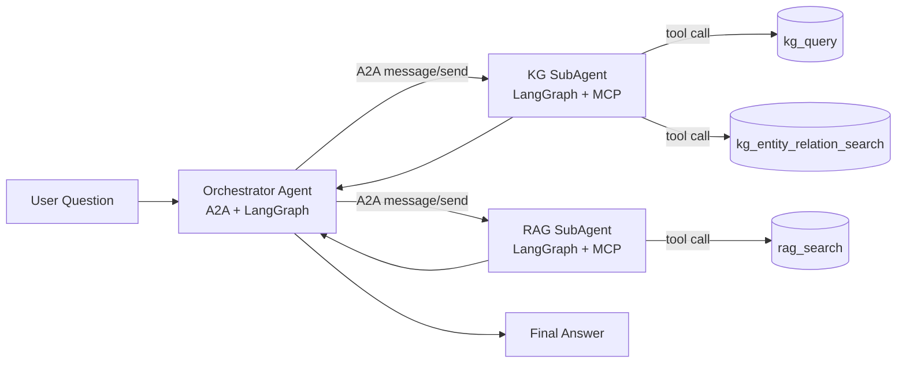
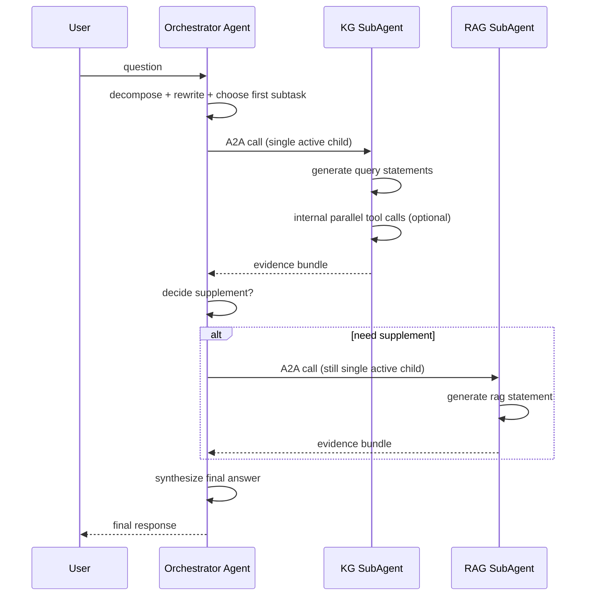

# A2A + LangGraph 主子 Agent 重构详细设计（主串行、子自治）

## 1. 设计目标（按你的约束固化）

1. 主 Agent 只做问题逻辑分解、问题重构、轮次决策、补检索决策与终答汇总。
2. 主 Agent 在任意时刻只能调用一个子 Agent（严格串行）。
3. 子 Agent 负责把接收到的问题转成具体检索语句并执行。
4. 子 Agent 是否并发调用数据库由子 Agent 自主决定。
5. 子 Agent 只处理当前收到的问题，不做额外补检索或扩展检索轮次。
6. 是否补检索由主 Agent 唯一决策。
7. 主 Agent + 两个子 Agent 通过原生 `a2a-sdk` 协作。
8. 每个 Agent 内部流程使用 `LangGraph` 编排。
9. 工具分工：
- KG 子 Agent：`kg_query` + `kg_entity_relation_search`
- RAG 子 Agent：`rag_search`

---

## 2. 总体架构





---

## 3. 目录与文件规划

> 说明：优先复用你当前路径，避免大规模迁移。`app/a2a/service.py|models.py|cards.py` 当前几乎为空，正好作为重建入口。

```text
app/
  a2a/
    __init__.py
    cards.py
    models.py
    service.py
    runtime/
      sdk_server.py
      request_context.py
    client/
      subagent_client.py
    orchestrator/
      state.py
      policies.py
      nodes.py
      graph.py
      executor.py
    subagents/
      kg/
        state.py
        query_builder.py
        nodes.py
        graph.py
        executor.py
      rag/
        state.py
        query_builder.py
        nodes.py
        graph.py
        executor.py
    mcp/
      tool_gateway.py
```

---

## 4. A2A 协议层详细设计（原生 SDK）

## 4.1 `app/a2a/runtime/sdk_server.py`

函数模块：

| 函数/类 | 职责 | 输入 | 输出 |
|---|---|---|---|
| `build_request_handler(agent_executor)` | 用 `DefaultRequestHandler` 绑定执行器与任务存储 | AgentExecutor | RequestHandler |
| `build_fastapi_app(agent_card, request_handler, rpc_url, card_url)` | 用 `A2AFastAPIApplication` 构建 A2A 路由 | card/handler/路由 | FastAPI app |
| `mount_agent_app(root_app, mount_path, agent_app)` | 挂载主/子 Agent 的 A2A 子应用 | 主 app + 子 app | None |
| `A2AServerBundle` | 保存 app/card/handler/executor 引用，便于统一管理 | 初始化参数 | bundle 对象 |

SDK 对齐点：
- `a2a.server.request_handlers.DefaultRequestHandler`
- `a2a.server.agent_execution.AgentExecutor`
- `a2a.server.apps.jsonrpc.fastapi_app.A2AFastAPIApplication`

## 4.2 `app/a2a/client/subagent_client.py`

函数模块：

| 函数/类 | 职责 | 输入 | 输出 |
|---|---|---|---|
| `SubAgentClientFactory` | 封装 `ClientFactory`，按 Agent Card 创建 client | config + card | client |
| `send_task(agent_key, request)` | 主 Agent 调用子 Agent（非流式） | 目标 agent + 请求 | 标准响应 |
| `send_task_stream(agent_key, request)` | 可选流式调用子 Agent | 同上 | async generator |
| `normalize_subagent_response(raw)` | 把 A2A 返回统一成主 Agent 可消费结构 | raw A2A result | `SubAgentResult` |

约束实现：
- 主 Agent 端所有子 Agent 调用都经过该文件，便于集中加“串行闸门”。

## 4.3 `app/a2a/cards.py`

函数模块：

| 函数 | 职责 |
|---|---|
| `build_orchestrator_card()` | 主 Agent Card（skills: decomposition, orchestration, supplement-decision） |
| `build_kg_subagent_card()` | KG 子 Agent Card（skills: kg-query-generation, kg-evidence-retrieval） |
| `build_rag_subagent_card()` | RAG 子 Agent Card（skills: rag-query-generation, chunk-retrieval） |
| `all_agent_cards()` | 返回三张卡，供 `/a2a/agents` 与启动时注册 |

## 4.4 `app/a2a/models.py`

核心模型（Pydantic）：

| 模型 | 关键字段 | 作用 |
|---|---|---|
| `UserQuestion` | `question, session_id, user_id, trace_id` | 统一入口输入 |
| `SubTask` | `subtask_id, target_agent, question, intent, constraints` | 主 Agent 派发单元 |
| `SubAgentConstraints` | `allow_extra_retrieval=False, max_tool_calls` | 强约束子 Agent 行为 |
| `SubAgentResult` | `query_statements, tool_results, evidence, no_signal, token_usage` | 子 Agent 标准输出 |
| `EvidenceBundle` | `kg_evidence, rag_evidence, citations` | 主 Agent 汇总证据 |
| `OrchestratorDecision` | `need_supplement, next_agent, next_question, reason` | 补检索决策 |
| `FinalAnswer` | `answer, confidence, evidence_summary, trace` | 最终输出 |

---

## 5. 主 Agent（Orchestrator）LangGraph 设计

## 5.1 `app/a2a/orchestrator/state.py`

| 字段 | 含义 |
|---|---|
| `user_question` | 用户原问题 |
| `decomposed_subtasks` | 当前待执行子任务列表 |
| `current_subtask` | 当前执行的单个子任务 |
| `evidence_bundle` | 证据累计 |
| `retrieval_round` | 当前检索轮次 |
| `max_retrieval_rounds` | 最大补检索轮次 |
| `last_subagent_result` | 最近一次子 Agent 输出 |
| `final_decision` | 是否终答 |

## 5.2 `app/a2a/orchestrator/policies.py`

| 函数 | 职责 |
|---|---|
| `decompose_question(question)` | 问题逻辑分解（主 Agent 专属） |
| `rewrite_subquestion(subtask)` | 子问题重构（主 Agent 专属） |
| `select_next_subagent(subtask, evidence_bundle)` | 决定调 KG 还是 RAG |
| `decide_need_supplement(evidence_bundle, round, max_rounds)` | 唯一补检索策略入口 |
| `build_final_answer(evidence_bundle, question)` | 终答生成 |

## 5.3 `app/a2a/orchestrator/nodes.py`

| Node 函数 | 功能 | 备注 |
|---|---|---|
| `node_parse_input` | 解析入参，初始化状态 | 起点 |
| `node_decompose_and_rewrite` | 逻辑分解 + 子问题重构 | 主 Agent 核心职责 |
| `node_pick_next_subtask` | 选择本轮唯一子任务 | 只选一个 |
| `node_call_subagent_serial` | 调子 Agent（A2A） | 内部加 semaphore=1 |
| `node_merge_evidence` | 合并子 Agent 证据 | 不做额外检索 |
| `node_decide_supplement` | 判断是否补检索 | 唯一决策口 |
| `node_finalize_answer` | 输出最终答案 | 终点 |

## 5.4 `app/a2a/orchestrator/graph.py`

| 函数 | 职责 |
|---|---|
| `build_orchestrator_graph()` | 组装 StateGraph 节点与条件边 |
| `route_after_supplement_decision(state)` | `continue` or `finalize` 路由 |
| `compile_orchestrator_graph()` | 编译图并返回可执行对象 |

状态流：
- `parse_input -> decompose_and_rewrite -> pick_next_subtask -> call_subagent_serial -> merge_evidence -> decide_supplement -> (pick_next_subtask | finalize_answer)`

## 5.5 `app/a2a/orchestrator/executor.py`

| 函数/类 | 职责 |
|---|---|
| `class OrchestratorExecutor(AgentExecutor)` | A2A 执行器实现 |
| `execute(context, event_queue)` | 读取消息，执行 LangGraph，推送 Task/Artifact 事件 |
| `cancel(context, event_queue)` | 响应取消请求 |
| `_emit_progress(event_queue, text, metadata)` | 推送中间状态 |
| `_emit_final(event_queue, final_answer)` | 推送终态与 artifacts |

---

## 6. KG 子 Agent LangGraph 设计

## 6.1 `app/a2a/subagents/kg/state.py`

| 字段 | 含义 |
|---|---|
| `input_question` | 主 Agent 下发的问题 |
| `constraints` | `allow_extra_retrieval=False` 等 |
| `kg_query_payload` | 给 `kg_query` 的语句/参数 |
| `kg_er_payload` | 给 `kg_entity_relation_search` 的参数 |
| `tool_calls` | 实际执行记录 |
| `tool_results` | MCP 返回 |
| `final_result` | 子 Agent 输出 |

## 6.2 `app/a2a/subagents/kg/query_builder.py`

| 函数 | 职责 |
|---|---|
| `build_kg_query_payload(question)` | 生成 `kg_query` 参数（keyword/cypher/limit） |
| `build_kg_entity_relation_payload(question)` | 生成 `kg_entity_relation_search` 参数 |
| `validate_generated_payload(payload)` | 防御式校验，避免非法/越权参数 |

## 6.3 `app/a2a/subagents/kg/nodes.py`

| Node 函数 | 功能 |
|---|---|
| `node_validate_constraints` | 强制 `allow_extra_retrieval=False` |
| `node_generate_query_statements` | 仅基于收到问题生成查询语句 |
| `node_execute_tools` | 调 MCP 工具；可内部并发执行两个工具 |
| `node_normalize_results` | 标准化工具结果 |
| `node_build_response` | 产出 `SubAgentResult` |

## 6.4 `app/a2a/subagents/kg/graph.py`

| 函数 | 职责 |
|---|---|
| `build_kg_graph()` | KG 子 Agent 图编排 |
| `compile_kg_graph()` | 编译并返回 runnable graph |

## 6.5 `app/a2a/subagents/kg/executor.py`

| 函数/类 | 职责 |
|---|---|
| `class KgSubAgentExecutor(AgentExecutor)` | A2A 执行入口 |
| `execute(context, event_queue)` | 执行 KG LangGraph 并发回事件 |
| `cancel(context, event_queue)` | 支持取消 |

---

## 7. RAG 子 Agent LangGraph 设计

## 7.1 `app/a2a/subagents/rag/state.py`

字段：`input_question, constraints, rag_payload, tool_results, final_result`

## 7.2 `app/a2a/subagents/rag/query_builder.py`

| 函数 | 职责 |
|---|---|
| `build_rag_payload(question)` | 生成 `rag_search` 参数（query/top_k/source_filter） |
| `validate_rag_payload(payload)` | 防御式校验 |

## 7.3 `app/a2a/subagents/rag/nodes.py`

| Node 函数 | 功能 |
|---|---|
| `node_validate_constraints` | 禁止额外补检索 |
| `node_generate_query_statement` | 仅对当前问题生成查询语句 |
| `node_execute_rag_search` | 调用 `rag_search` |
| `node_normalize_results` | 标准化命中片段 |
| `node_build_response` | 输出 `SubAgentResult` |

## 7.4 `app/a2a/subagents/rag/graph.py`

`build_rag_graph()`、`compile_rag_graph()`

## 7.5 `app/a2a/subagents/rag/executor.py`

`class RagSubAgentExecutor(AgentExecutor)`、`execute()`、`cancel()`

---

## 8. MCP 适配层设计

## `app/a2a/mcp/tool_gateway.py`

| 函数 | 职责 |
|---|---|
| `invoke_tool(tool_name, payload)` | 单工具调用封装 |
| `invoke_batch(calls, allow_parallel=True)` | 批量调用，供子 Agent 内部并发 |
| `normalize_mcp_result(result)` | 统一 `ok/error/meta/token_usage` |
| `ensure_allowed_tools(agent_type, tool_name)` | 工具白名单控制 |

白名单策略：
- KG 子 Agent 仅允许：`kg_query`, `kg_entity_relation_search`
- RAG 子 Agent 仅允许：`rag_search`
- 非白名单直接拒绝（避免越界）

---

## 9. 服务编排与入口

## 9.1 `app/a2a/service.py`

| 函数/类 | 职责 |
|---|---|
| `build_orchestrator_bundle()` | 构建主 Agent 的 card + executor + app |
| `build_kg_bundle()` | 构建 KG 子 Agent bundle |
| `build_rag_bundle()` | 构建 RAG 子 Agent bundle |
| `register_all_agents(root_fastapi_app)` | 将三个 A2A app 挂载到主服务 |
| `class A2AService` | 兼容层，保留 `send_message/get_task/list_tasks/handle_rpc` 旧调用习惯 |

推荐路由：
- 主 Agent：`/a2a/orchestrator/rpc`
- KG 子 Agent：`/a2a/kg/rpc`
- RAG 子 Agent：`/a2a/rag/rpc`
- 卡片：`/.well-known/agent-card.json`（各自子 app 下）

## 9.2 `app/backend/main.py`（改造点）

| 修改点 | 说明 |
|---|---|
| 初始化阶段调用 `register_all_agents(app)` | 一次挂载三类 Agent 服务 |
| 现有 `/a2a/rpc` 路径保留兼容 | 代理到 orchestrator 或做 307 跳转 |
| `/agent/run` 走 orchestrator A2A 客户端 | 保持前端兼容 |

---

## 10. 关键约束的代码级落地

## 10.1 主 Agent 同时只能调用一个子 Agent

- 在 `node_call_subagent_serial` 使用 `asyncio.Semaphore(1)`。
- 禁止 `asyncio.gather([kg_call, rag_call])` 这类并发子 Agent 调用。
- 每轮只允许一个 `current_subtask` 进入执行。

## 10.2 子 Agent 不得额外补检索

- 输入约束字段：`constraints.allow_extra_retrieval=False`。
- 子 Agent 节点 `node_validate_constraints` 直接硬校验。
- 子 Agent 内部不允许创建新的 follow-up question。
- 若结果不足只返回 `no_signal=True` + `reason`，由主 Agent 决策是否继续。

## 10.3 子 Agent 可自主并发数据库调用

- KG 子 Agent 在 `node_execute_tools` 中可并发 `kg_query` 与 `kg_entity_relation_search`。
- 并发只发生在子 Agent 内部 MCP 调用，不扩展检索轮次。

---

## 11. 事件与 Artifact 规范

主 Agent 最终 artifacts：

1. `final_answer`：最终回答文本。
2. `evidence_bundle`：融合后的证据。
3. `orchestration_trace`：主 Agent 的决策轨迹（分解、调用顺序、补检索判断）。
4. `token_usage`：全链路 token 汇总。

子 Agent artifacts：

1. `query_statements`：本次生成的查询语句。
2. `tool_observations`：本次工具调用结果。
3. `subagent_summary`：本次问题的证据摘要。

---

## 12. 测试设计

新增测试文件：

- `tests/test_orchestrator_single_child_call.py`
- `tests/test_kg_subagent_no_extra_retrieval.py`
- `tests/test_rag_subagent_no_extra_retrieval.py`
- `tests/test_subagent_tool_whitelist.py`
- `tests/test_a2a_end_to_end_orchestrator_kg_rag.py`

关键断言：

1. 主 Agent 任意时间窗口最多 1 个子 Agent 调用处于 running。
2. 子 Agent 调用次数与输入子任务数一致，不多发检索。
3. KG 子 Agent 只调用 `kg_query`/`kg_entity_relation_search`。
4. RAG 子 Agent 只调用 `rag_search`。
5. 当 `no_signal=True` 时，由主 Agent 决定是否补检索。

---

## 13. 分阶段实施顺序（建议）

1. 重建 `app/a2a/models.py`、`cards.py`、`service.py`（先把协议骨架跑通）。
2. 先落地 KG 子 Agent（最复杂），再落地 RAG 子 Agent。
3. 落地主 Agent LangGraph 串行调度与补检索决策。
4. 接入 `backend/main.py` 并保持旧接口兼容。
5. 最后补全端到端与并发约束测试。

---

## 14. 验收标准

1. 主 Agent 只负责分解/重构/调度/补检索决策与终答，不直接做底层检索语句生成。
2. 主 Agent 同时只调用一个子 Agent。
3. 子 Agent 每次只响应收到的问题，不做额外补检索。
4. 子 Agent 内部可独立并发工具调用。
5. 全链路基于原生 A2A SDK 通讯，Agent 内部通过 LangGraph 编排。

